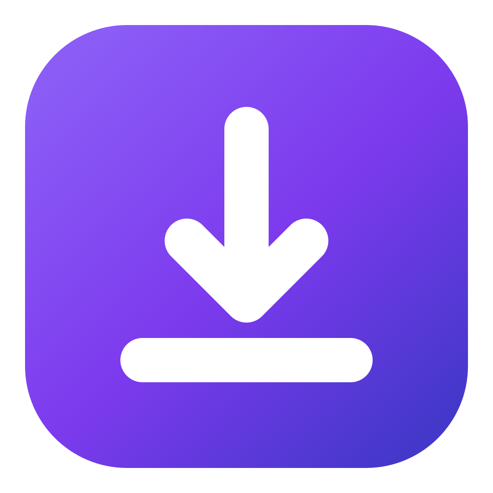

<div align="center">



# Downlink

**Desktop video and audio downloader with a modern interface**

[](https://github.com/SyberFoxx/downlink/actions/workflows/ci.yml)
[](https://opensource.org/licenses/MIT)
[](https://tauri.app)
[](https://svelte.dev)

**English** | [Español](README.es.md)

</div>

---

## What is Downlink?

Downlink is a desktop app (with Android on the way) for downloading video and audio from **over 1800 websites** — YouTube, TikTok, Instagram, X/Twitter, Twitch, Reddit and many more — with a clean, fast interface built for the end user.

Under the hood it uses [yt-dlp](https://github.com/yt-dlp/yt-dlp) and `ffmpeg` as external processes: either the ones already on your system, or copies the app itself downloads and keeps up to date. That gives you always-current site support without giving up a native experience.

### Why Downlink and not something else?

| | Downlink | MeTube | YTDLnis |
|---|---|---|---|
| Modern interface (Svelte 5) | ✅ | ❌ (basic web UI) | ⚠️ rough |
| Desktop (Linux/Windows) | ✅ | ⚠️ via browser | ❌ |
| Android | 🚧 planned | ❌ | ✅ |
| Visual format selector | ✅ | ❌ | ⚠️ |
| One-click presets | ✅ | ❌ | ✅ |
| Drag-and-drop queue | ✅ | ❌ | ❌ |
| History with gallery | ✅ | ⚠️ basic | ✅ |
| Clip trimming | ✅ | ❌ | ✅ |
| Subtitles (download and embed) | ✅ | ❌ | ✅ |
| Automatic engine and JS runtime | ✅ | ❌ | ✅ |

## Features

### Downloading and queue
- 🎯 **Paste a link and go** — detects the platform and shows a preview (thumbnail, title, duration and channel)
- 📋 **Smart queue** — several downloads at once, with individual pause and resume
- 🧲 **Drag to reorder** — the order you place pending items in is the order they download
- 🖱️ **Drop links onto the window** — or paste several at once with `Ctrl+V`
- 🎬 **Playlists and channels** — list every video, pick the ones you want and queue them in one go
- 🔢 **Configurable concurrency** — 1 to 8 simultaneous downloads to suit your connection
- 📂 **Show in folder** — one click to open the finished file

### Formats and audio
- 🎞️ **Visual format selector** — real resolutions for the link, plus MP4/MKV/WEBM containers
- 🎵 **Every audio format** — MP3, M4A, OGG, OPUS, FLAC, WAV or the original without re-encoding
- 🔊 **Volume control** — raise or lower ±20 dB and normalize the audio with `ffmpeg`
- ⚡ **One-click presets** — best quality, 1080p video, MP3 320k, FLAC or original audio
- 🏷️ **Automatic metadata** — title, artist and cover art embedded into audio files

### Trimming and subtitles
- ✂️ **Trim a clip** — set a start and end (`mm:ss` or `h:mm:ss`) and download just that part
- 💬 **Subtitles** — grab them in any languages you want (`en,es`…), auto-generated included
- 🧩 **Embedded or as a file** — embed them into the video (MP4/MKV) or leave them as separate `.srt` files

### History
- 🖼️ **Download gallery** — every completed download keeps its thumbnail, date, size and options
- 🔍 **Instant search** — filter by title or link across all your downloads
- ♻️ **One-click re-download** — repeat a download with the same options as the first time
- 💾 **Local persistence** — your history lives on your machine and survives restarts

### Desktop
- 📂 **Configurable download folder** — choose where files go (created if missing)
- 🛡️ **SponsorBlock** — remove or mark YouTube promo segments (sponsorship, intro, outro, filler…)
- 💾 **Persistent queue** — pending items are saved and restored when you reopen the app; yt-dlp resumes the partial file
- 🔔 **Notifications** — a system notice when a download finishes or fails, only if the window isn't focused
- 📌 **System tray** — menu with “Show” and “Quit”, live queue status and an option to close to the tray
- 🔄 **Retry** — failed or cancelled jobs go back to the queue with the same options

### Engine and compatibility
- 🧩 **Engine detection** — shows where each binary comes from (system, managed by Downlink or bundled with the app)
- ⬆️ **yt-dlp auto-update** — downloads its own copy from the official releases, verifies it (SHA-256 and a real run) and keeps it current
- 📥 **ffmpeg without the hassle** — if you don't have it, Downlink downloads its own copy (together with `ffprobe`), verifies it like yt-dlp and uses it on its own; if it's already on your system, it's respected
- 🧠 **Automatic JS runtime** — if you don't have Node.js, Deno or Bun, Downlink downloads its own interpreter (quickjs, ~2.5 MB) so yt-dlp can solve YouTube's challenges; nothing to install by hand anymore
- 🍪 **Browser cookies** — uses your Brave, Firefox, Chrome and friends session for YouTube and restricted content
- 🔧 **Engine status** — yt-dlp, JS runtime and ffmpeg detected and tested from Settings

### Appearance
- 🎨 **Themes** — 10 included (Dark, Light, Catppuccin, Nord, Dracula, Gruvbox, Tokyo Night, Rosé Pine, Solarized…), applied instantly
- 🖌️ **Accent color** — pick the color for buttons, focus and progress, or keep the theme's own
- 🖼️ **Wallpaper** — put your desktop wallpaper behind the panels, with adjustable intensity and blur
- 🐧 **Blends into your desktop** — automatic mode follows the system light/dark setting and adopts your **pywal/wallust** palette (Hyprland and other *ricing* setups)

## Install

Installers for each version are published automatically to [GitHub Releases](https://github.com/SyberFoxx/downlink/releases):

| Platform | Format |
|---|---|
| Debian / Ubuntu | `.deb` → `sudo apt install ./Downlink_*.deb` |
| Fedora / openSUSE | `.rpm` → `sudo dnf install ./Downlink-*.rpm` (or `sudo zypper install ./Downlink-*.rpm`) |
| Any Linux distro | `AppImage` → `chmod +x Downlink_*.AppImage && ./Downlink_*.AppImage` |
| Windows 10 / 11 | `.msi` or `.exe` (NSIS) — install and you're done |

macOS has no package of its own yet (it's on the [roadmap](#roadmap)); for now you can run it from source with `npm run tauri dev`.

You don't need to install yt-dlp, ffmpeg or a JS runtime: if it can't find them on your system, Downlink downloads and maintains its own copies.

### Building locally

```bash
npm run tauri build                            # deb + rpm + AppImage (Linux) / MSI + NSIS (Windows)
npm run tauri build -- --bundles deb,rpm       # only the formats you want
```

Installers end up in `src-tauri/target/release/bundle/`. On Linux you need the development packages (`libayatana-appindicator3-dev` on Debian/Ubuntu, `libayatana-appindicator-gtk3-devel` on Fedora) and, for the AppImage, `libfuse2` and `patchelf`.

## Stack

- **[Tauri 2](https://tauri.app)** — native shell and lightweight binary for Linux and Windows (Android on the way)
- **[Svelte 5](https://svelte.dev)** + **[SvelteKit](https://kit.svelte.dev)** — reactive interface, no virtual DOM
- **[Rust](https://www.rust-lang.org)** — backend: download queue, external processes and real-time events
- **[yt-dlp](https://github.com/yt-dlp/yt-dlp)** — download engine (a copy managed by the app, or your own)
- **[ffmpeg](https://ffmpeg.org)** — conversion, remuxing and metadata embedding
- **[quickjs](https://github.com/quickjs-ng/quickjs)** — lightweight JS runtime for YouTube's challenges (optional if you already use Node.js, Deno or Bun)

## Requirements

To develop:

- [Rust](https://rustup.rs) (stable)
- [Node.js](https://nodejs.org) (LTS, 20 or newer)
- Tauri's system dependencies [for your OS](https://tauri.app/start/prerequisites/)

On Fedora:

```bash
sudo dnf install webkit2gtk4.1-devel libsoup3-devel librsvg2-devel \
  openssl-devel libayatana-appindicator-gtk3-devel gcc
```

On Debian/Ubuntu:

```bash
sudo apt install libwebkit2gtk-4.1-dev build-essential curl wget file \
  libxdo-dev libssl-dev libayatana-appindicator3-dev librsvg2-dev
```

To **use** the app you don't need to install `yt-dlp`, `ffmpeg` or a JS runtime: Downlink downloads its own copies if they're missing.

## Troubleshooting

**“Sign in to confirm you're not a bot”**

YouTube blocks by IP when there are too many requests or the session isn't valid. Fix:

1. Open **Settings** → Cookies → **From browser** and pick your browser (with an active YouTube session).
2. Hit **Test connection** to verify.
3. If it still fails, close the browser (so its cookie database isn't locked) and try again.

**“n challenge solving failed”**

A JS runtime is missing. Downlink downloads one on the first run; if that doesn't happen, go to **Settings → Engine → JS runtime** and click **Download**. You can also install `node` or `deno` yourself if you prefer.

## Development

```bash
git clone https://github.com/SyberFoxx/downlink.git
cd downlink
npm install

# App in development mode (with hot reload)
npm run tauri dev
```

Before submitting changes, these checks must be clean:

```bash
npm run check                                            # Svelte and TypeScript types
npm run build                                            # frontend build
cd src-tauri && cargo fmt --all                          # Rust formatting
cd src-tauri && cargo clippy --all-targets -- -D warnings # lints
cd src-tauri && cargo test                               # unit tests
```

## Project structure

```
downlink/
├── src/                     # Svelte 5 frontend (SvelteKit with adapter-static)
│   ├── routes/+page.svelte  # Layout and view switching (Downloads/History/Appearance/Settings)
│   └── lib/                 # Components, views, reactive state and API wrappers
├── src-tauri/               # Rust backend
│   ├── src/
│   │   ├── main.rs          # Entry point
│   │   ├── lib.rs           # Tauri setup, commands and global state
│   │   ├── queue.rs         # Download queue (states, concurrency, order, pause)
│   │   ├── queue_store.rs   # Queue persistence (queue.json)
│   │   ├── engine.rs        # Resolving yt-dlp/ffmpeg/quickjs and their source
│   │   ├── updater.rs       # Download and auto-update of the engines (GitHub Releases)
│   │   ├── history.rs       # Persisted history (history.json)
│   │   ├── settings.rs      # Persisted settings and browser detection
│   │   ├── theme.rs         # Wallpaper and pywal/wallust palette
│   │   ├── tray.rs          # System tray icon
│   │   └── ytdlp.rs         # yt-dlp arguments, parsing and output
│   ├── Cargo.toml
│   └── tauri.conf.json      # Window, bundle and identifier configuration
├── docs/                    # Extra documentation (Android plan)
└── .github/workflows/       # CI (Linux + Windows) and release publishing
```

## Roadmap

### v0.1 — Foundations ✅
- [x] Tauri 2 + Svelte 5 scaffold
- [x] Base interface: sidebar layout and dark theme
- [x] Paste a link → metadata analysis → preview card
- [x] Download with a real-time progress bar
- [x] Browser cookies, EJS solver and Settings view (v0.1.1)

### v0.2 — Formats and audio ✅
- [x] Visual format selector (video/audio, real resolutions)
- [x] MP4/MKV/WEBM containers with MP4-compatible codecs
- [x] Audio formats (MP3/M4A/OGG/OPUS/FLAC/WAV/original)
- [x] Volume control and normalization with `ffmpeg`
- [x] Configurable presets

### v0.3 — Smart queue ✅
- [x] Multiple jobs with states (queued, downloading, processing, paused…)
- [x] Pause and resume without starting over
- [x] Reorder pending items by dragging
- [x] Configurable concurrency (1–8 simultaneous downloads)
- [x] Paste or drop several links at once

### v0.4 — Playlists ✅
- [x] Playlist and channel detection when analyzing a link
- [x] Video list with title and duration
- [x] Select individually, all or none
- [x] Queue the chosen videos in one go

### v0.5 — History ✅
- [x] History with gallery, search and re-download
- [x] Local persistence of what you downloaded

### v0.6 — Trimming and subtitles ✅
- [x] Clip trimming (`--download-sections`)
- [x] Subtitles (download and embed)

### v0.7 — Engine and maturity ✅
- [x] Engine source detection (managed, sidecar or system)
- [x] yt-dlp auto-update (SHA-256 and real-run verification)
- [x] ffmpeg download (Linux/Windows) when missing
- [ ] Bundle yt-dlp and ffmpeg as *sidecars* inside the installer

### v0.8 — Themes and appearance ✅
- [x] Design-token system to repaint the app without recompiling
- [x] 10 themes, automatic light/dark mode and pywal/wallust palette
- [x] Custom accent color and wallpaper with intensity and blur
- [x] Appearance view

### v0.9 — Desktop ✅
- [x] Configurable download folder
- [x] SponsorBlock: remove or mark promo segments by category
- [x] Persistent queue across sessions (`queue.json`)
- [x] Notifications on finish (only if the window isn't focused)
- [x] System tray with queue status and close-to-tray
- [x] Retry failed or cancelled jobs and global notices (toasts)
- [x] Paste or drop links from any view
- [x] Own brand: logo and app icons

### v0.10 — Distribution and robustness ✅
- [x] Official `.deb`, `.rpm`, AppImage, `.msi` and NSIS installers, published to GitHub Releases
- [x] Fix for `ffmpeg` and `node` not starting inside the AppImage (v0.10.1)
- [x] Windows fixes: browser detection, no CMD windows and automatic JS runtime (v0.10.2)

### v1.0 — Android 📱
- [ ] Port to Tauri 2 mobile (arm64)
- [ ] Mobile-adapted interface (gestures, bottom navigation, safe areas)
- [ ] yt-dlp and ffmpeg packaged per architecture (arm64)

Detailed plan (blockers, adaptations and phases): **[docs/android-v1.md](docs/android-v1.md)**.

> iOS is out of scope: the app launches `yt-dlp` and `ffmpeg` as external processes, and iOS doesn't allow spawning child processes.

See the [CHANGELOG](CHANGELOG.md) for the details of each version.

## Contributing

Read [CONTRIBUTING.md](CONTRIBUTING.md). In short: `main` is always stable, branches are `feature/*` (or `fix/*`), conventional commits, PR with green CI and squash merge.

## License

[MIT](LICENSE) © Ramses Sotomayor
